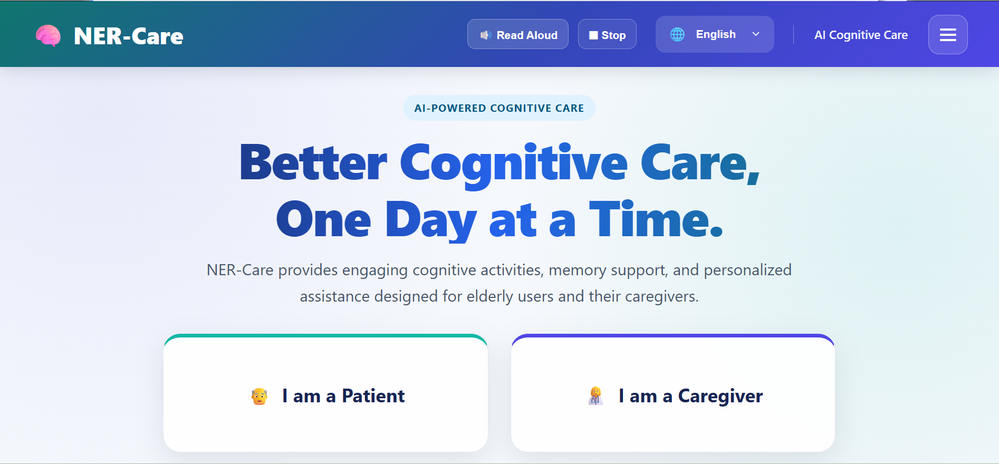
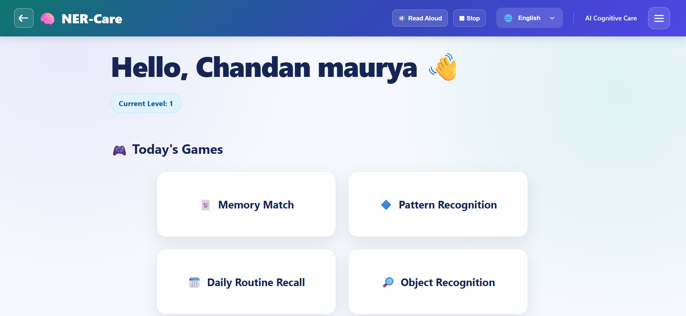
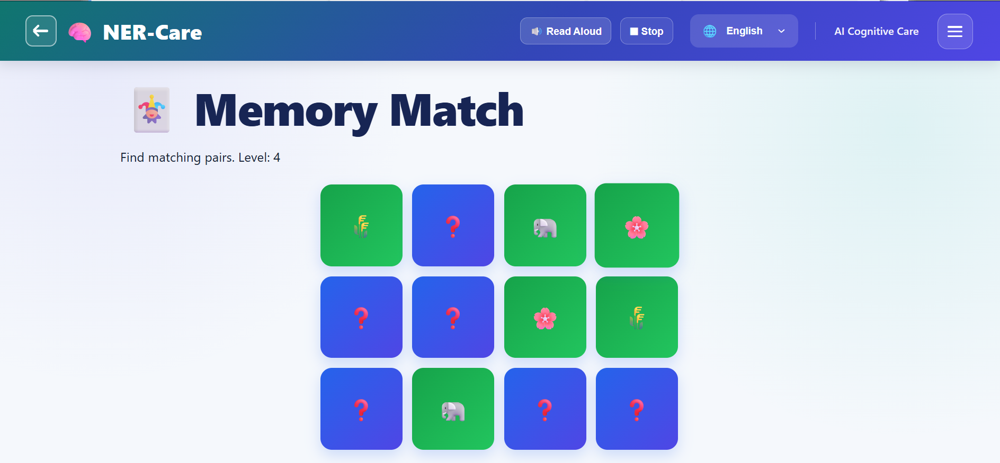
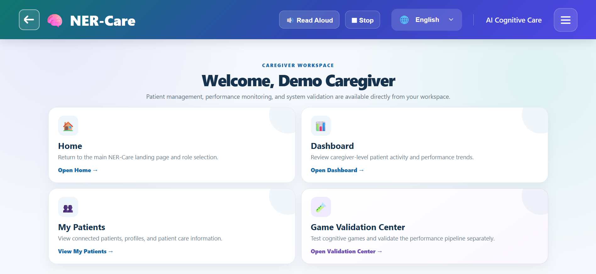
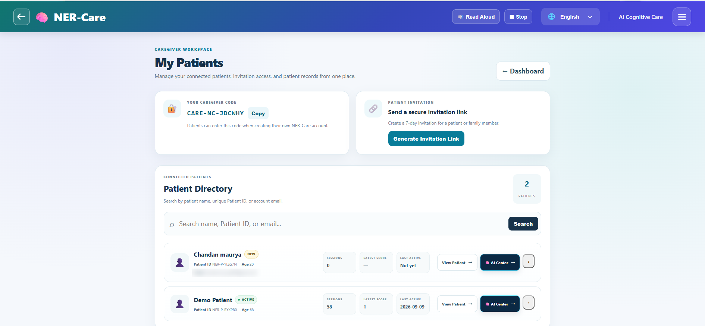
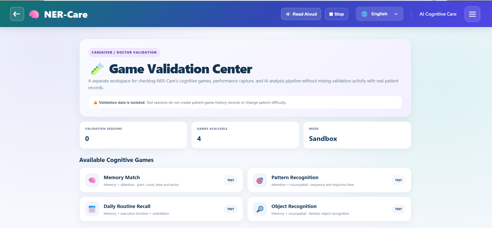
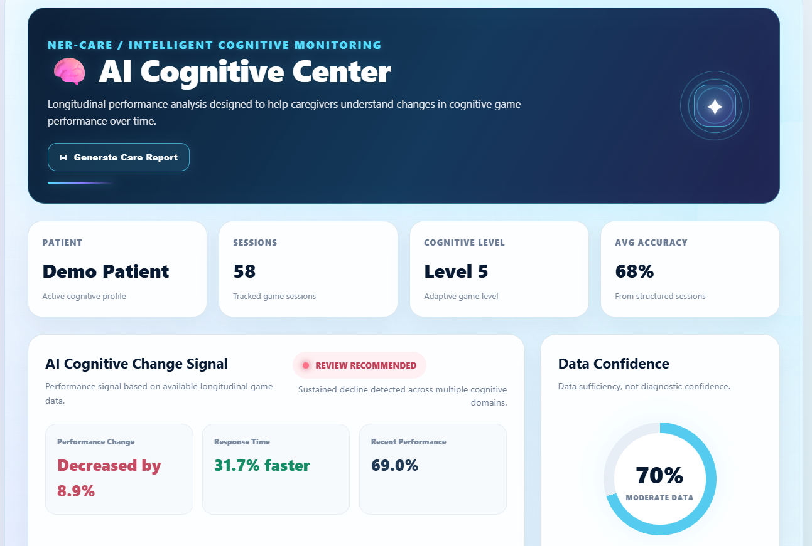

<div align="center">

# 🧠 NER-Care

### AI-powered cognitive games and memory support for elderly dementia patients in North East India

**Smart India Hackathon 2026 · Problem Statement PS 26003**

[**▶ Try the live demo**](https://nitish.pythonanywhere.com) &nbsp;·&nbsp; [Screenshots](#-screenshots) &nbsp;·&nbsp; [Features](#-features) &nbsp;·&nbsp; [How it works](#-how-it-works) &nbsp;·&nbsp; [Run locally](#-run-locally)




</div>

---

## 💡 Why NER-Care

Dementia care in the North Eastern Region is hard to reach. There are few specialists, many languages, and families often notice memory changes only when they are already advanced.

**NER-Care gives patients short, easy-to-use brain games, and gives caregivers a clear, explainable picture of how performance changes over time**, in a language the patient actually speaks.

> ⚠️ **NER-Care is a monitoring and decision-support tool. It is NOT a medical device and does NOT diagnose dementia.** Its signals are prompts for a caregiver to talk to a healthcare professional.

---

## 📸 Screenshots

### 👵 Patient experience

Large buttons, simple words, one task per screen, and a **Read Aloud** button on every page.

| Patient dashboard | Playing a game |
|:---:|:---:|
|  |  |
| A personal greeting, the patient's current level, and today's four games in one tap | Memory Match at level 4: flip cards and find the pairs. Difficulty adapts to how the patient is doing |

### 🧑‍⚕️ Caregiver experience

| Caregiver workspace | My Patients |
|:---:|:---:|
|  |  |
| One home for the dashboard, connected patients and the validation center | Share a caregiver code or a secure 7-day invitation link, then search patients and see sessions, latest score and last activity |

| Game Validation Center | AI Cognitive Center |
|:---:|:---:|
|  |  |
| A sandbox to test the games and the analysis pipeline. **Test sessions never touch real patient records** | Longitudinal analysis: a change signal with its reason, response time trend, recent performance and a data-confidence meter |

---

## ✨ Features

### For patients
- 🎮 **4 cognitive games** with **adaptive difficulty** (levels 1 to 5)
- 👓 **Elderly-friendly design**: big fonts, big buttons, high contrast, no clutter
- 🔊 **Read Aloud** (text-to-speech) for pages and instructions
- 🌐 **6 interface languages**: English, Hindi, Assamese, Bengali, Manipuri and Khasi
- ⏰ **Daily reminders** for medicine, meals and activities
- 👤 Personal profile and full play history

### For caregivers
- 🔗 **Connect patients** by caregiver code or a secure, expiring invitation link
- 📇 **Patient directory** with search by name, patient ID or email
- 🧬 **AI Cognitive Center**: trends per cognitive domain, an explainable change signal, a personalised practice plan and a **Care Report**
- 📝 **Caregiver observations** (sleep, mood, medication, routine...) that add real-world context to the game data
- 🧪 **Validation sandbox** to test games without polluting patient history

### The games

| Game | Cognitive domains trained |
|---|---|
| 🃏 **Memory Match** | memory, attention |
| 🔷 **Pattern Recognition** | attention, visuospatial |
| 🗓️ **Daily Routine Recall** | memory, executive function, orientation |
| 🔎 **Object Recognition** | memory, visuospatial |

Each game is played in short rounds. Each completed round is saved as one session.

---

## 🔧 How it works

```
 Patient plays a game ──► POST /api/submit-score ──► SQLite (game_scores)
                                                          │
          Adaptive difficulty (next level) ◄──────────────┤
                                                          ▼
                       Analytics engine ──► Caregiver dashboard · AI Cognitive Center
```

| Idea | What it means |
|---|---|
| **Universal data layer** | Every game sends the same kind of result: score, accuracy, time, errors and the **cognitive domains** it trains. The analytics engine works with *domains*, never hard-coded game names, so new games plug in without changing it. |
| **Explainable change detection** | Recent sessions are compared with an earlier baseline for overall performance, response time and each domain. Every signal (`STABLE`, `MONITOR`, `REVIEW RECOMMENDED`, `IMPROVING`) comes with the reason that produced it. |
| **Data sufficiency, not diagnosis** | The *Data Confidence* meter shows **how much data exists**, never how likely a condition is. |
| **Adaptive difficulty** | A transparent rule-based engine (`compute_next_difficulty`) raises or lowers the level from accuracy and speed. It is isolated so a trained ML model can replace it later. |
| **Privacy by design** | Patients see only their own data. Caregivers see only the patients linked to them. Validation data is kept in separate tables. |

**Tech stack:** Python · Flask · SQLite · Jinja2 · vanilla JavaScript · Chart.js · Web Speech API (Read Aloud)

---

## 🚀 Run locally

Requires **Python 3.9+**.

```bash
pip install -r requirements.txt
python app.py
```

Open **http://localhost:5000**. On Windows you can also just double-click `run.bat`.
The SQLite database `nercare.db` is created automatically on the first run.

**Quick tour:** choose *I am a Caregiver* and register, then copy your caregiver code and register a patient with it. Or log in to the demo caregiver account (`demo@nercare.local` / `Demo@123`).

---

## ➕ Add a new game

No change to the analytics engine is needed. A new game just needs a page, a route, and to post its result:

```json
POST /api/submit-score
{
  "patient_id": 1,
  "game_name": "sequence_recall",
  "score": 4, "max_score": 5, "accuracy": 0.8,
  "time_taken_seconds": 42, "expected_time_seconds": 50,
  "errors": 1,
  "domains": ["memory", "attention"]
}
```

Use a fixed `game_name` and domains from: `memory`, `attention`, `processing_speed`, `executive_function`, `visuospatial`, `language`, `orientation`. The game is registered automatically and appears in all analytics.

---

## 📁 Project structure

```
app.py             Flask backend: routes, database, analytics, adaptive difficulty
templates/         HTML pages (Jinja2)
static/css/        Large, high-contrast, elderly-friendly styling
screenshots/       Images used in this README
requirements.txt   Python dependencies
run.bat / run.sh   One-click start
nercare.db         SQLite database (created automatically, not stored in git)
```

## ☁️ Deployment

Hosted free on **PythonAnywhere**, which has a persistent disk so SQLite data survives restarts. The WSGI entry point is `from app import app as application`. Keep `nercare.db` writable and out of git.

## 🗺️ Roadmap

- [ ] Voice input for answers (speech-to-text)
- [ ] Offline play with background sync (Service Worker)
- [ ] Separate difficulty progression for each game
- [ ] Difficulty-adjusted trend analysis
- [ ] Train an ML model for difficulty and risk signals on real usage data
- [ ] Encryption of patient data before any real-world use

---

## 👥 Team

Built for **SIH 2026** by **Nitish Kumar** and team.

## 📄 Disclaimer

Educational prototype. Not a medical device. Not intended to diagnose, treat or prevent any condition. Do not use for clinical decisions. Demo screenshots use sample data.
